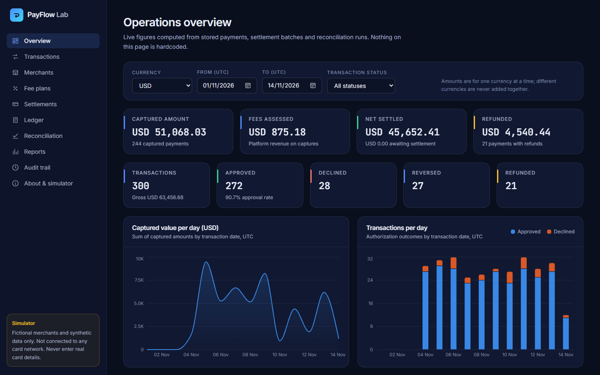
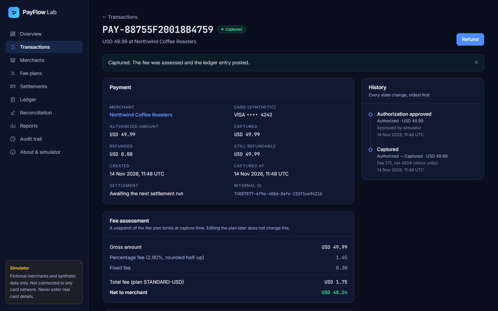
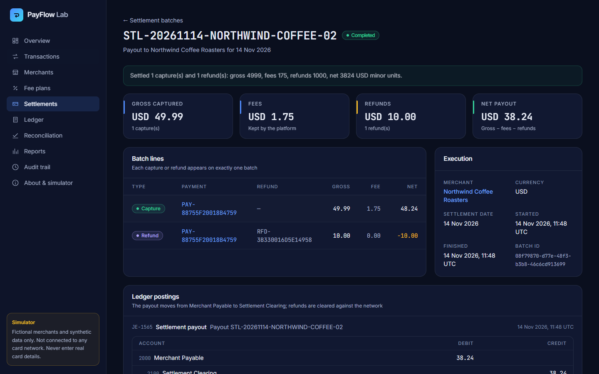
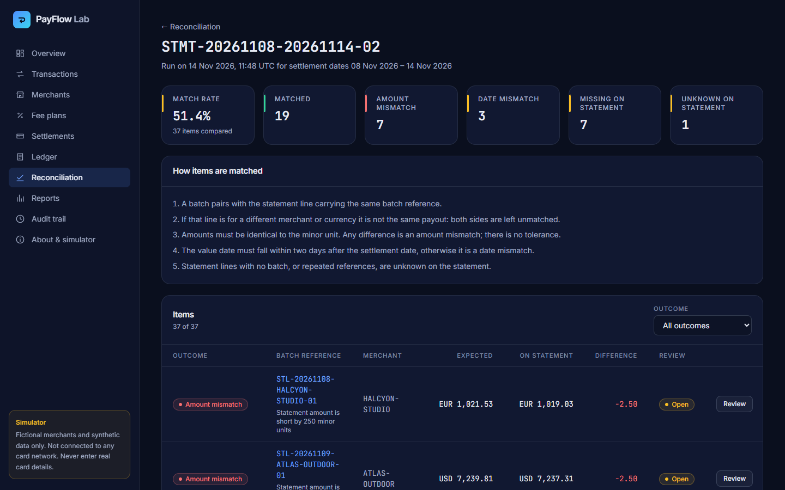
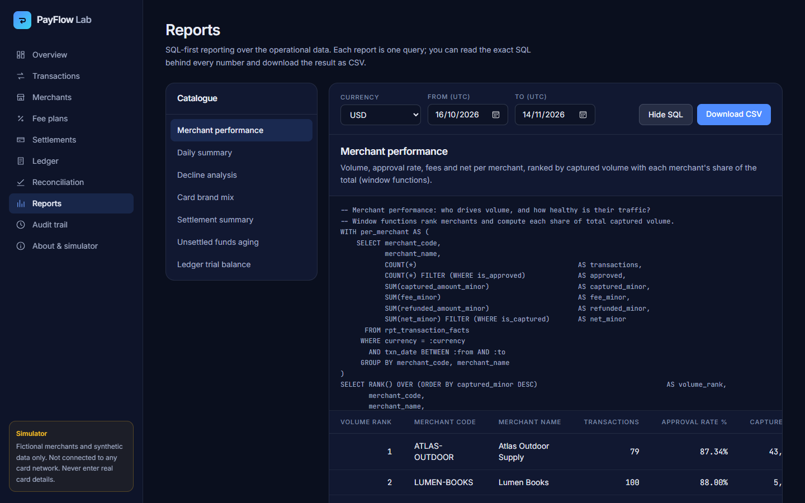
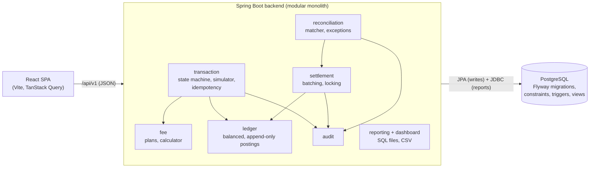

# PayFlow Lab

**A simulated card payment operations platform: authorization, capture, refunds, fee assessment, a double-entry ledger, settlement batching, reconciliation and SQL reporting.**

Java 21 · Spring Boot 4 · PostgreSQL · Flyway · React · TypeScript

> **PayFlow Lab is an educational simulator.** It connects to no card network, bank or processor and moves no real money. Every merchant, reference and amount is fictional. It is not PCI DSS certified, has not been security audited, and must never be given real card or customer data.

---

## What it demonstrates

| Area | What is implemented |
|---|---|
| **Payment lifecycle** | A state machine (`AUTHORIZED → CAPTURED → PARTIALLY_REFUNDED → REFUNDED`, plus `DECLINED` and `REVERSED`) enforced in the domain layer. Invalid transitions are rejected with `409`. |
| **Deterministic simulator** | Authorizations are approved or declined by fixed rules (amount limit, "magic" last-four digits, or an explicit scenario). No randomness, so tests are never flaky. |
| **Money correctness** | Integer minor units everywhere, never floating point. Fees use explicit half-up rounding. A fee plan belongs to one currency; currencies are never added together. |
| **Idempotency** | `Idempotency-Key` on money-moving requests. Same key and payload replays the original result; same key with a different payload is rejected; concurrent duplicates produce exactly one effect. |
| **Double-entry ledger** | Append-only journal. PostgreSQL itself rejects unbalanced entries (deferred constraint trigger), edits and deletes (row triggers), and duplicate postings (unique constraint). |
| **Settlement** | Operator-triggered batch per merchant: gross, fees, refunds and net. Row locks plus partial unique indexes make double settlement impossible, including under concurrent runs. |
| **Reconciliation** | Completed batches are matched against a synthetic external statement. Any difference becomes an exception that a person reviews with a note. Nothing is ever "close enough". |
| **SQL reporting** | Seven reports, each a plain `.sql` file using CTEs and window functions over reporting views. The API returns the exact SQL with the result, and exports CSV. |
| **Audit trail** | Every state change writes an audit event in the same transaction as the change. |

## Screens

Operations overview · Transactions and payment detail · Merchants · Fee plans with a fee calculator · Settlement batches · Ledger explorer · Reconciliation and exception queue · Reports · Audit trail · About / simulator notice.

### Screenshots

Captured from the running application with the seeded fictional demo data.

| Operations overview | Payment detail with fee breakdown |
|---|---|
|  |  |

| Settlement batch | Reconciliation run |
|---|---|
|  |  |

| Reports with the SQL shown |
|---|
|  |

## Architecture

A modular monolith: one deployable backend, one database, one single-page app.



More detail: [docs/architecture.md](docs/architecture.md) · data model and ER diagram: [docs/domain-model.md](docs/domain-model.md).

## Run it

### Option 1: Docker Compose

```bash
cp .env.example .env
docker compose up --build
```

- UI: http://localhost:5173
- API: http://localhost:8080/api/v1
- Swagger UI: http://localhost:8080/swagger-ui.html

Flyway creates the schema on startup, and the fictional demo dataset is loaded automatically when the database is empty.

### Option 2: no Docker, no PostgreSQL install

Needs only JDK 21 and Node 20+. The backend starts an embedded PostgreSQL for you.

```bash
# terminal 1: API on :8080 with an embedded PostgreSQL on :54329
cd backend
./mvnw spring-boot:test-run        # Windows: mvnw.cmd spring-boot:test-run

# terminal 2: UI on :5173
cd frontend
npm install
npm run dev
```

The embedded database lives in a temporary directory and is recreated on each start. You can point a SQL client or BI tool at `localhost:54329` (database `postgres`, user `postgres`, no password) to query the tables and `rpt_*` views directly.

### Reset the demo data

One command, or the **Reset demo data** button on the About page:

```bash
curl -X POST http://localhost:8080/api/v1/demo/reset
```

## Demo walkthrough

1. **Overview** (`/`): KPIs for the last 14 days, per currency.
2. **Merchants**: open *Northwind Coffee Roasters* and look at its fee plan.
3. **New payment**: from the merchant page, create a payment of `49.99`. Card last four `4242` is approved; `0002`, `0051` and `0119` are declined.
4. **Capture** it. The payment page now shows the fee breakdown (`2.90% + 0.30`) and a balanced journal entry.
5. **Refund** part of it, then try to refund more than remains: the API refuses.
6. **Settlements → Run settlement**: the payment is batched into a payout. Run it again: nothing is settled twice.
7. **Reconciliation → Generate statement** (with anomalies) **→ Reconcile**: see matched items and each exception type, then review one with a note.
8. **Reports**: open *Merchant performance*, select **Show SQL**, and download the CSV.

## API

Versioned under `/api/v1`; full OpenAPI at `/v3/api-docs` and Swagger UI at `/swagger-ui.html`. Ready-to-run requests are in [docs/api-examples.http](docs/api-examples.http).

```http
POST /api/v1/transactions
Idempotency-Key: order-1001-attempt-1
Content-Type: application/json

{ "merchantId": "…", "amountMinor": 4999, "currency": "USD", "cardBrand": "VISA", "cardLast4": "4242" }
```

Errors always have the same shape:

```json
{
  "timestamp": "2026-11-14T10:15:30Z",
  "status": 422,
  "errorCode": "REFUND_EXCEEDS_CAPTURED",
  "message": "Refund of 4001 exceeds the remaining refundable amount of 4000 (minor units)",
  "path": "/api/v1/transactions/…/refunds"
}
```

**How idempotency keys work.** The key is stored in the same database transaction as the effect it protects. A repeat with the same key and payload returns the original result with `Idempotent-Replay: true` and status `200`. The same key with a different payload returns `422 IDEMPOTENCY_KEY_REUSED`. If two identical requests race, a unique constraint lets exactly one commit.

## Tests

```bash
cd backend  && ./mvnw verify          # unit + integration tests on a real embedded PostgreSQL
cd frontend && npm run typecheck && npm run lint && npm test && npm run build
```

Backend tests cover the state machine, simulator rules, fee rounding boundaries, idempotency and replay, concurrent refunds and captures, balanced and duplicate ledger postings, the database-level ledger guards, settlement eligibility and concurrent runs, reconciliation outcomes, validation and the error envelope, dashboard and report figures against a hand-checked dataset, and the invariants of the seeded demo data. Frontend tests cover money parsing/formatting and the critical payment flows.

What was actually run, and what was not, is recorded in [IMPLEMENTATION_STATUS.md](IMPLEMENTATION_STATUS.md).

## Deployment

See [docs/deployment.md](docs/deployment.md) for environment variables, build commands, deployment order and troubleshooting. No hosted demo exists yet.

## Limitations

- A simulator: no real networks, no real money, no real card data. Not production-certified and not PCI DSS compliant.
- No authentication or user accounts. Every action is attributed to a single "demo-operator". Do not expose a deployment with demo reset enabled.
- Three currencies (USD, EUR, PKR), all with two minor digits. Zero- and three-decimal currencies are rejected. No currency conversion.
- Captures are for the full authorized amount; partial capture is not supported.
- The processing fee is not returned on refund.
- The ledger model is deliberately small and internally consistent. It does not represent every real acquirer's or issuer's accounting.
- Statements are generated synthetically; there is no file import yet.
- No rate limiting.

## Roadmap

- CSV statement import and reconciliation export
- Role-based operator permissions
- Webhook event simulation with retry handling
- Posting payouts to a bank account when reconciliation confirms them
- Additional currencies with explicit minor-unit rules
- Metrics and tracing

## Licence

[MIT](LICENSE)
