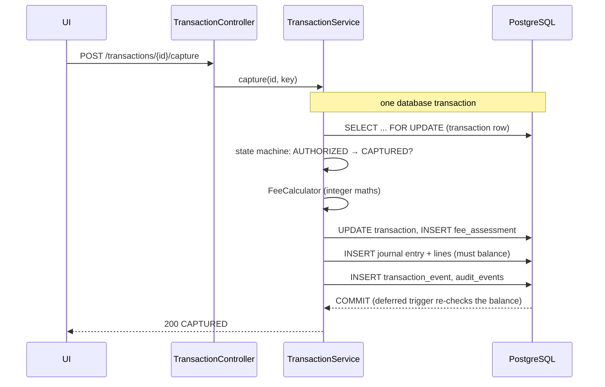

# Architecture

## Shape

PayFlow Lab is a **modular monolith**: one Spring Boot application, one PostgreSQL database, one React single-page app. There is no message broker, cache or service mesh, because no feature needs one. Modules are Java packages with a narrow public surface; they call each other in-process.

```
backend/src/main/java/com/payflowlab
├── common          clock, error envelope, paging, CORS/OpenAPI config
├── fee             fee plans, FeeCalculator (pure), fee assessment snapshots
├── merchant        merchants and their status
├── transaction     state machine, simulator, idempotency, refunds
├── ledger          chart of accounts, journal entries, posting service
├── settlement      batch processor, run orchestration, optional scheduler
├── reconciliation  statements, matcher (pure), runs, exception review
├── audit           audit events
├── dashboard       overview KPIs (SQL)
├── reporting       SQL-file report engine, CSV export
└── demo            demo data seeder and reset
```

Dependency direction: `transaction → fee, ledger`; `settlement → transaction, ledger`; `reconciliation → settlement`; everything `→ audit, common`. Nothing depends on `demo`, `dashboard` or `reporting`.

## Request flow: capturing a payment



The payment, its fee snapshot, its ledger entry, its history event and its audit events commit together or not at all.

## Financial invariants and where they are enforced

Each invariant is enforced in the application **and** in the database. The database is the last line of defence, so a bug in application code cannot corrupt money.

| Invariant | Application | Database | Tested by |
|---|---|---|---|
| Only valid state transitions | `TransactionStatus.canTransitionTo`, called by every mutator on `Transaction` | `CHECK` on allowed status values | `TransactionRulesTest`, `TransactionLifecycleIT` |
| Refunds never exceed the captured amount | `Transaction.refund` under a row lock | `CHECK (refunded_amount_minor BETWEEN 0 AND captured_amount_minor)` | `TransactionLifecycleIT`, `IdempotencyAndConcurrencyIT` (10 concurrent refunds) |
| Money is never fractional | `long` minor units; strict JSON rejects `10.50` | `BIGINT` columns | `ApiContractIT`, `FeeCalculatorTest` |
| A duplicate request has one effect | `IdempotencyService` in the operation's transaction | `UNIQUE (idempotency_key, operation)` | `IdempotencyAndConcurrencyIT` (8 concurrent duplicates) |
| Every journal entry balances | `LedgerService.post` | deferred constraint trigger `journal_lines_balanced` | `LedgerIT` (including raw SQL inserts) |
| The ledger is append-only | no update paths; columns `updatable = false` | `BEFORE UPDATE OR DELETE` triggers | `LedgerIT` |
| A business event posts once | existence check in `LedgerService.post` | `UNIQUE (source_type, source_id, event_type)` | `LedgerIT` |
| A capture or refund settles once | merchant row lock, `FOR UPDATE` selection of unsettled rows | partial unique indexes on `settlement_batch_lines` | `SettlementIT` (6 concurrent runs, raw duplicate insert) |
| Batch net = gross − fees − refunds | computed in `SettlementBatch.totals` | `CHECK` on `settlement_batches` | `SettlementIT`, `DemoDataIT` |
| A mismatch is never recorded as a match | pure `ReconciliationMatcher`, exact comparison | `CHECK` tying outcome to review status | `ReconciliationMatcherTest`, `ReconciliationIT` |
| Currencies are never combined | every aggregate filters on one currency | fee plan and merchant currency must agree (service) | `DashboardAndReportsIT` |

## Concurrency

- **Capture, reverse, refund** take a `PESSIMISTIC_WRITE` lock on the transaction row. Racing operations queue; the second sees the first one's committed state before validating. `@Version` is a second guard.
- **Settlement** processes each merchant in its own `REQUIRES_NEW` transaction and first locks the merchant row, so two runs for the same merchant are serialised. One merchant failing does not roll back another's payout.
- **Idempotency** relies on a unique constraint rather than a read-then-write check, so it is correct under any interleaving.

## Time

All timestamps come from `AppClock`, stored as `TIMESTAMPTZ` in UTC. The clock is strictly monotonic within the process (two events can never share a timestamp, which matters on platforms whose system clock ticks coarsely) and can be pinned per thread, which is how the demo seeder replays ten days of history through the real services. Settlement cut-offs are UTC day boundaries.

## Reads versus writes

Writes go through JPA entities so the domain rules run. Dashboards and reports are read-only SQL through `JdbcTemplate` over three reporting views (`rpt_transaction_facts`, `rpt_daily_merchant_activity`, `rpt_account_balances`), so the operational tables stay normalised while analytics share one definition of each measure. A BI tool can query the same views directly.

## Frontend

React + TypeScript, built with Vite. TanStack Query handles fetching and caching; after any write, every cached read is invalidated, because payments, ledger, settlement and the dashboard are views of the same money. Amounts are converted between text and minor units by string/integer arithmetic, never `parseFloat`. The browser reaches the API through a same-origin proxy (Vite in development, nginx in production).

Chart series colours (`#3987e5`, `#d95926`) were checked against the dark surface for lightness, chroma, colour-vision-deficiency separation and contrast; status colours are always paired with a text label.

## Decisions and trade-offs

- **Spring Boot 4.1 instead of 3.x.** The 3.x line stopped receiving open-source releases in mid-2026; the project targets a currently supported release on Java 21.
- **No authentication.** A login adds little to a simulator and would get in the way of a public demo. The cost is stated plainly: one "demo-operator", and reset must be disabled on shared deployments.
- **Embedded PostgreSQL for tests and local development** (`io.zonky.test:embedded-postgres`) instead of Testcontainers, so tests need no Docker daemon and still run against the real engine, migrations and triggers.
- **Refunds are separate rows**, not transactions of a different type, so cumulative refund limits are a simple column check.
- **A non-positive net fails the batch.** A payout cannot be zero or negative; the items stay unsettled and net against later captures.
