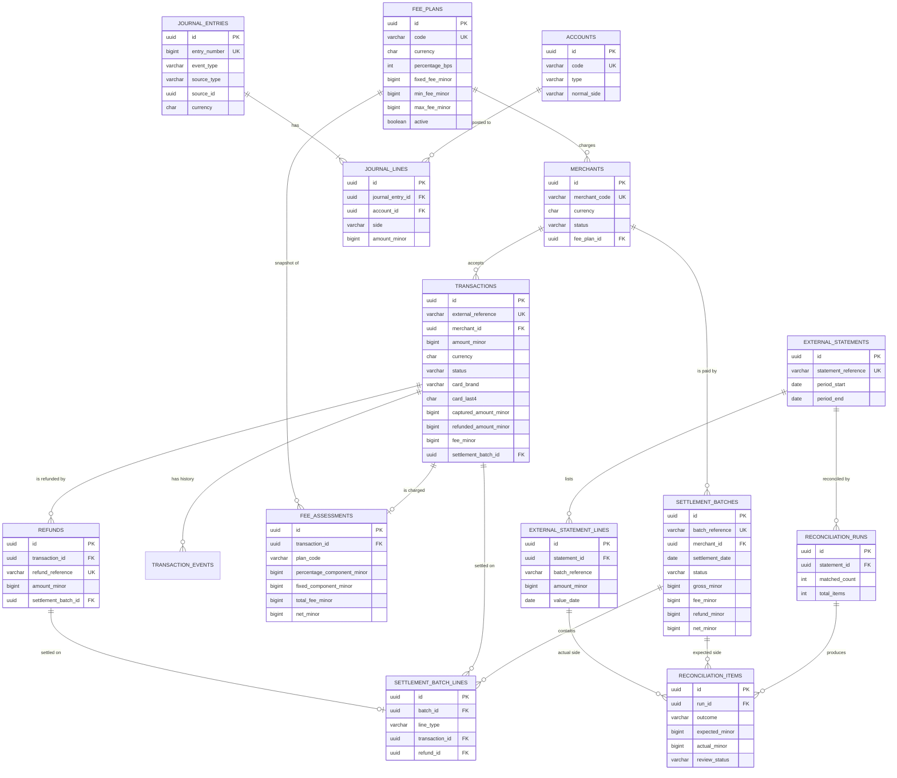
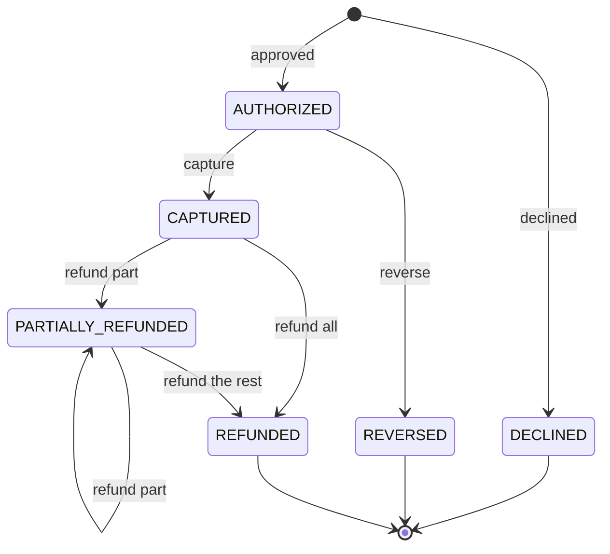

# Domain model

## Entity-relationship diagram

`transaction_events`, `audit_events` and `idempotency_records` are omitted from the diagram for readability; the full schema is in `backend/src/main/resources/db/migration`.

## Money

- Amounts are `BIGINT` **minor units** (cents, paisa). No floating point is used anywhere, in Java, SQL or TypeScript.
- Every amount is stored next to an ISO 4217 currency code.
- Supported currencies: USD, EUR, PKR. All have two minor digits. Others are rejected rather than guessed at.
- Amounts in different currencies are never added. Every aggregate (dashboard, reports, settlement, trial balance) is per currency.

## Payment state machine

## Simulator rules

Evaluated in order; the same input always gives the same result.

1. Scenario `FORCE_DECLINE` → declined (`SIMULATOR_FORCED_DECLINE`).
2. Scenario `FORCE_APPROVE` → approved, skipping the rules below.
3. Amount above 5,000,000 minor units → declined (`AMOUNT_LIMIT_EXCEEDED`).
4. Card last four `0002` → `INSUFFICIENT_FUNDS`; `0051` → `EXPIRED_CARD`; `0119` → `SUSPECTED_FRAUD`.
5. Otherwise → approved.

A suspended merchant cannot authorize at all (`409 MERCHANT_SUSPENDED`).

## Fee calculation and rounding policy

Assessed once, at capture, on the captured amount:

1. `percentage component = round_half_up(amount × bps / 10000)`, computed as `(amount × bps + 5000) / 10000` in integer arithmetic.
2. `raw fee = percentage component + fixed fee`.
3. If a plan minimum is set and the fee is below it, the minimum applies. Then, if a maximum is set and the fee is above it, the maximum applies.
4. The fee is capped at the transaction amount, so the net is never negative.

`net = gross − fee`. The breakdown, together with the plan terms in force at that moment, is stored in `fee_assessments`. Editing a fee plan later never changes a fee already assessed.

Example with `2.90% + 0.30` on `100.00`: percentage `2.90`, fixed `0.30`, fee `3.20`, net `96.80`.

## Chart of accounts and posting rules

| Code | Account | Type | Normal side |
|---|---|---|---|
| 1000 | Network Receivable (simulated card-network clearing) | Asset | Debit |
| 2000 | Merchant Payable | Liability | Credit |
| 2100 | Settlement Clearing | Liability | Credit |
| 2200 | Refund Clearing | Liability | Credit |
| 4000 | Fee Revenue | Revenue | Credit |

| Event | Debit | Credit |
|---|---|---|
| Authorization, reversal | none: no money moves | |
| Capture of gross `G`, fee `F` | 1000 Network Receivable `G` | 2000 Merchant Payable `G − F`; 4000 Fee Revenue `F` |
| Refund of `R` | 2000 Merchant Payable `R` | 2200 Refund Clearing `R` |
| Settlement payout of net `N` | 2000 Merchant Payable `N` | 2100 Settlement Clearing `N` |
| Refunds cleared at settlement, total `R` | 2200 Refund Clearing `R` | 1000 Network Receivable `R` |

After a merchant is fully settled, its Merchant Payable and Refund Clearing balances are zero; Settlement Clearing holds the payouts in transit and Fee Revenue holds the fees earned.

**Assumptions.** The processing fee is not returned on refund. Payouts are not yet posted to a bank account when reconciliation confirms them (see the roadmap). Corrections are made with new compensating entries, never by editing. This is a small, internally consistent teaching model, not a description of how any particular acquirer keeps its books.

## Settlement

A run for settlement date `D` takes, per merchant, every capture and refund not yet settled with a timestamp before the end of `D` (UTC), and creates one batch:

`net = Σ captured − Σ fees − Σ refunds`

- `net > 0`: batch `COMPLETED`, lines written, items marked settled, ledger posted.
- `net ≤ 0`: batch `FAILED` with reason `NET_NOT_POSITIVE`; nothing is settled and the items carry forward to the next run.

Refunds made after a payment was settled are deducted from the merchant's next batch.

## Reconciliation matching

Expected side: completed batches whose settlement date is in the statement's period. Actual side: the statement's lines. For each batch reference:

| Situation | Outcome |
|---|---|
| No statement line has the reference | `UNMATCHED_INTERNAL` |
| A line has the reference but a different merchant or currency | batch `UNMATCHED_INTERNAL` and line `UNMATCHED_EXTERNAL` |
| Amounts differ by any amount | `AMOUNT_MISMATCH` |
| Value date outside settlement date … settlement date + 2 days | `DATE_MISMATCH` |
| Everything agrees | `MATCHED` |
| Statement line with an unknown or repeated reference | `UNMATCHED_EXTERNAL` |

Reviewing an exception records a note and a timestamp. It never changes the outcome.
